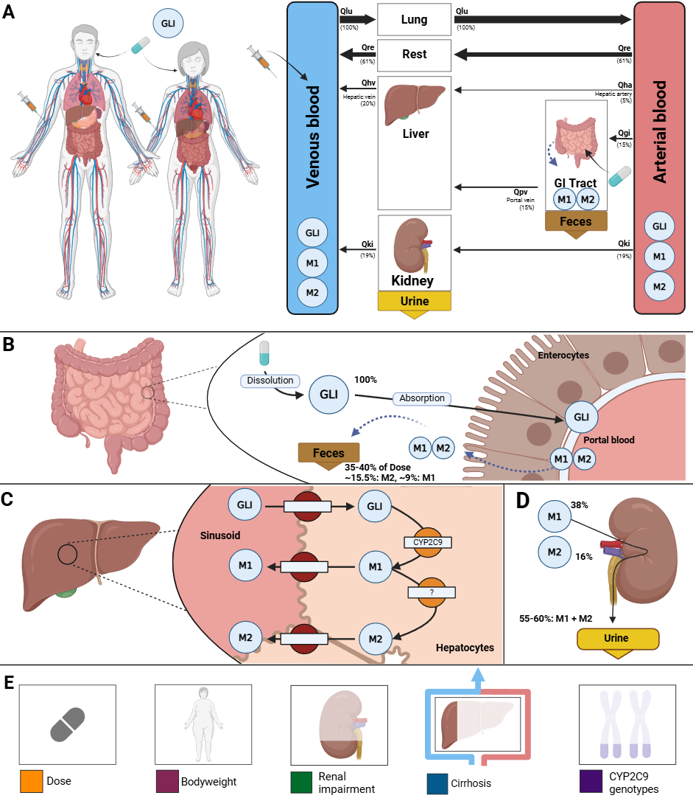

# Glimepiride: a model app without a server

The whole-body PBPK model of glimepiride and its metabolites M1 and M2 as an app of interactive panels. Move a knob or load an example patient and the four curves follow. Every simulation runs in your browser, on [sbmlsim-core](https://matthiaskoenig.github.io/sbmlsim-core/) in a pool of Web Workers over the cores of your machine: this page is static files and talks to no simulation server.

<sbmlsim-app endpoint="local:glimepiride" model="glimepiride" heading-level="2"></sbmlsim-app>

<script type="module" src="glimepiride/register.mjs"></script>

[Open the app on a page of its own](glimepiride/app.html){ .md-button }

## The model

{ align=right width=300 }

**A)** Whole-body PBPK model illustrating glimepiride (GLI) administration, its systemic circulation via venous and arterial blood, and the key organs (liver, kidney, GI tract) involved in GLI metabolism, distribution, and excretion.

**B)** Intestinal model showing dissolution and absorption of GLI by enterocytes. No enterohepatic circulation of M1 and M2 is assumed, but reverse transport via enterocytes is included.

**C)** Hepatic model depicting CYP2C9-mediated metabolism of GLI to M1 and M2.

**D)** Renal model highlighting the elimination of M1 and M2 via urine; unchanged GLI is not excreted renally.

**E)** Key factors influencing glimepiride disposition accounted for by the model: administered dose, bodyweight, renal impairment, liver function (cirrhosis), and CYP2C9 genotypes.

The model is the male build of the glimepiride model of [pkdb_models](https://github.com/matthiaskoenig/pkdb_models), and the app is its declaration: the four panels and their six knobs are an annotation of its SBML, the page and its twelve example patients the `App` of its project. The knobs without a target of their own (the creatinine clearance and the activities of the two CYP2C9 alleles) set the renal function and the hepatic CYP2C9 activity of the model through formulas the panels declare.

## How it is built

The app is the same app the sbmlsim service serves (`python -m sbmlsim.serve --model glimepiride=pkdb_models.models.glimepiride:MODEL`), with the service replaced by files and a function of the page:

1. **The bundle.** `python -m sbmlsim.serve --model glimepiride=... --export DIR` writes everything the service answers without simulating into `bundle/bundle.json` (the contract `panelbundle/1`): the app, the declarations of the panels and their study data, exactly as the routes answer them, and per panel the recipe of a run (the targets and unit factors of the knobs, the factors of the curves, the output times in the unit of the axis, the tolerances of the project). The formulas of the derived targets are compiled into the SBML as initial assignments over a parameter per knob, so nothing of the model is evaluated in JavaScript.
2. **The compiled model.** [sbmlsim-core](https://matthiaskoenig.github.io/sbmlsim-core/) compiles that SBML into `model.wasm` (92 kB) with its description `model.json`; its engine `engine.wasm` (CVODE with the sparse solver KLU, 660 kB) runs it.
3. **The endpoint inside the page.** `register.mjs` registers a function of the page as the endpoint `local:glimepiride` ([an endpoint inside the page](../endpoints.md#an-endpoint-inside-the-page)), and the app is one element, `<sbmlsim-app endpoint="local:glimepiride" model="glimepiride">`.

The module is all the code of the page:

```js
import { createPanelEndpoint } from './sbmlsim-core/panels.mjs'

sbmlsimWeb.registerEndpoint(
  'local:glimepiride',
  createPanelEndpoint({ bundle: new URL('./bundle/bundle.json', import.meta.url) }),
)
```

The elements send their requests to the function instead of the network; it answers them from the bundle and runs every point of a grid as a simulation on the pool of workers. The four panels of the page share one simulation, so a state of the knobs costs one scan, a few milliseconds per point.

The curves agree with the answers of the sbmlsim service, which simulates the same panels with roadrunner, to 1e-11 of their peak. The assets are written by `scripts/glimepiride.sh` of this repository from checkouts of sbmlsim, sbmlsim-core and pkdb_models (`SOURCES.json` names their commits).

## Reference

**A Digital Twin of Glimepiride for Personalized and Stratified Diabetes Treatment.** Michelle Elias, Matthias König (2025). Preprints 2025, 2025061264 (preprint). [doi:10.20944/preprints202506.1264.v1](https://doi.org/10.20944/preprints202506.1264.v1)

## Disclaimer

The software is provided **AS IS**, without warranty of any kind, express or implied, including but not limited to the warranties of merchantability, fitness for a particular purpose and noninfringement. In no event shall the authors or copyright holders be liable for any claim, damages or other liability, whether in an action of contract, tort or otherwise, arising from, out of or in connection with the software or the use or other dealings in the software.

This software is a **research proof-of-principle** and not fit for any clinical application. It is not intended to diagnose, treat, or inform medication dosing decisions. Always consult with qualified healthcare professionals for medical advice and treatment planning.

The model is licensed under CC BY-SA 4.0 and the source code under MIT; `engine.wasm` contains SUNDIALS (BSD-3-Clause) and KLU (LGPL-2.1-or-later), whose [notices](glimepiride/sbmlsim-core/THIRD_PARTY.md) ship with it.
